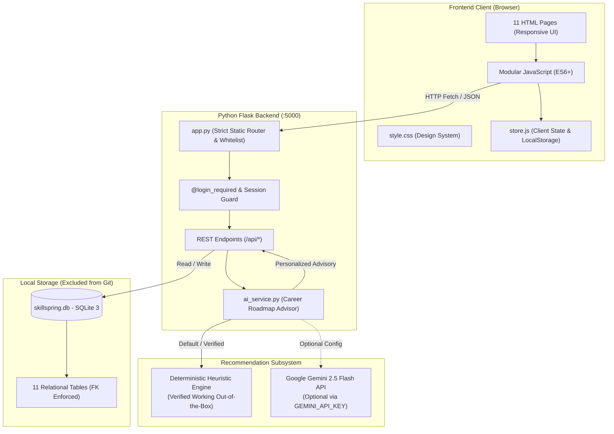
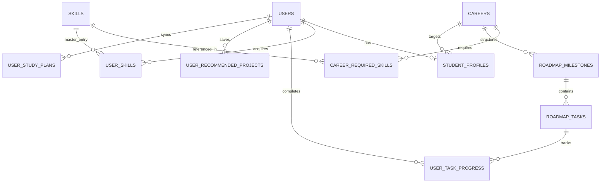
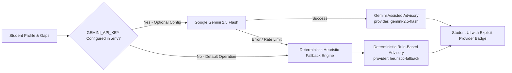

# SkillSpring - AI-Powered Career & Skill Roadmap Platform

[](https://www.python.org/)
[](https://flask.palletsprojects.com/)
[](https://www.sqlite.org/)
[](https://developer.mozilla.org/en-US/docs/Web/JavaScript)
[](https://developer.mozilla.org/en-US/docs/Web/HTML)
[](https://developer.mozilla.org/en-US/docs/Web/CSS)
[](test_backend.py)
[](app.py)

> **A personalized career readiness, skill gap analysis, and adaptive learning roadmap platform engineered for undergraduate engineering students and early-career developers to bridge academic curricula with current industry hiring standards.**

---

## 1. Project Title & Overview

**SkillSpring** is an end-to-end career guidance and roadmap web application developed as an undergraduate B.Tech engineering capstone project. In typical engineering colleges, academic syllabi focus predominantly on foundational theory, creating a disconnect with modern software engineering expectations. SkillSpring bridges this gap by evaluating a student's acquired skills, benchmarking them against curated industry career tracks, calculating precise competency deficits, and synthesizing actionable 6-week milestones.

### Dual-Engine Recommendation Architecture
- **Verified Working Engine (Deterministic Heuristic Fallback):** The primary verified, fully functional recommendation engine running out-of-the-box. Operates completely offline with zero API key dependencies, computing weighted gap scores, milestone priority strips, portfolio project suggestions, and weekday/weekend study allocations.
- **Optional AI Enhancement (Google Gemini 2.5 Flash):** An optional cloud AI integration that dynamically activates when a valid `GEMINI_API_KEY` is configured in the environment, providing contextual natural-language summaries and generative curriculum adaptation.

---

## 2. Problem Statement

Undergraduate computer science and engineering students frequently encounter three major challenges when preparing for technical placements and internships:
1. **Curriculum vs. Industry Disconnect:** University coursework emphasizes core theory (automata, compiler design, basic algorithms) but provides minimal structured exposure to production-grade tools such as Docker, container orchestration, CI/CD pipelines, or cloud infrastructure.
2. **One-Size-Fits-All Learning Paths:** Generic online tutorials treat all students uniformly regardless of existing competencies, causing advanced students to repeat basics while beginners struggle with advanced prerequisites.
3. **Absence of Actionable Roadmaps:** While students often identify a target role (e.g., Cloud & DevOps Engineer), they lack a structured weekly schedule with measurable milestones, hands-on tasks, and portfolio-grade project deliverables.

---

## 3. Project Objectives

- **Objective 1 — Profile & Competency Management:** Enable students to maintain an academic profile with fine-grained skill proficiency tracking (10% to 100%) and committed weekly study hours.
- **Objective 2 — Quantitative Gap Analysis:** Calculate an objective Career Readiness Percentage ($0\% - 100\%$) and categorize skills into *Strong Skills*, *Developing Skills*, and *Critical Missing Gaps* using industry weights.
- **Objective 3 — Actionable 6-Week Roadmaps:** Deliver chronological weekly milestones with interactive task checkboxes, real-time progress updates, and SQLite database persistence.
- **Objective 4 — Transparent Advisory:** Provide personalized weekly guidance with full provider transparency, explicitly distinguishing between verified heuristic recommendations and Gemini-assisted advice.
- **Objective 5 — Roadmap Synchronization:** Enable students to save recommended projects and synchronize adaptive weekly study plans directly into their persistent roadmap view.
- **Objective 6 — Robust Security & Data Isolation:** Enforce user-level data isolation, Werkzeug `scrypt` password hashing, path traversal protection, and strict static file whitelisting.

---

## 4. Key Features

### 👤 Student Authentication & Profile Management
- Secure user registration and login utilizing Werkzeug's `scrypt` key derivation function with cryptographic salts.
- **One-Click Quick Demo Login:** Instant evaluation access via the "Quick Demo Login" button on `login.html`, establishing an authenticated session for sample student *Aarav Sharma* without requiring manual credential entry.
- Comprehensive profile customization: college, degree, branch, graduation year, target career track, and weekly study hours (`CHECK(weekly_hours <= 80)`).
- Interactive skill chips and fine-grained proficiency sliders (10%–100%) with custom skill addition and deletion.

### 🧭 Curated Engineering Career Tracks
Provides curated competencies, required tools, and industry benchmarks across four technical tracks:
1. **Python Developer:** Core Python, OOP, Flask, Django, PostgreSQL, REST APIs, Unit Testing, Docker.
2. **Web Developer:** HTML5, Semantic CSS3, JavaScript (ES6+), React/TypeScript, Node.js, Express, MongoDB, Git.
3. **Data Analyst:** Python, SQL, Pandas, NumPy, Data Visualization (Matplotlib/Seaborn), Power BI/Tableau, Statistical Analysis.
4. **Cloud & DevOps Engineer:** Linux administration, Shell Scripting, Git, Docker, Kubernetes, CI/CD (GitHub Actions), AWS/GCP basics, Terraform.

### 📊 Quantitative Skill Gap Analysis
- Computes overall **Career Readiness Score** using weighted aggregation:
  $$\text{Readiness} = \frac{\sum (\text{Proficiency}_i \times \text{Weight}_i)}{\sum \text{Max Points}} \times 100$$
- Visual competence breakdown: Acquired competencies vs. Required industry skills.
- Priority classifications: **High Priority** (missing critical requirements), **Medium Priority** (needs polish), and **Low Priority / Mastered** (proficient).

### 🗺️ Interactive 6-Week Learning Roadmap
- Chronological weekly progression with actionable tasks and verifiable checkpoints.
- Checkbox persistence in SQLite and `localStorage` with real-time completion recalculation.
- Dynamic roadmap progress indicator synchronized across the Dashboard and Progress Tracker.

### 💡 Career Roadmap Advisor
- Contextual career analysis using the student's actual skill profile, gap metrics, and committed study hours.
- **Provider Transparency Badge:** Clearly indicates whether advice is generated by the verified heuristic fallback engine or the optional Gemini integration.
- **Component State Switcher:** Preview live recommendations, shimmer loading skeleton, empty state, and error handling states.

### 📌 Interactive Project & Study Plan Synchronization
- **Add Recommended Project to Roadmap:** Saves recommended portfolio projects directly to the user's career roadmap, persisted in SQLite with duplicate prevention.
- **Sync Adaptive Weekly Study Plan:** Synchronizes weekday study blocks, weekend project milestones, and hourly allocations into the roadmap view.

### 📈 Progress Tracker & Analytics
- Activity streak counter and completed vs. pending milestone breakdowns.
- Visual weekly study distribution metrics and module completion summaries.

---

## 5. Technology Stack

| Layer | Technologies | Purpose |
| :--- | :--- | :--- |
| **Frontend** | HTML5, Semantic CSS3, Vanilla JavaScript (ES6+) | Responsive UI, state management, client-side caching |
| **Design System** | Custom SaaS CSS (`Inter` typography, CSS variables) | Slate/indigo aesthetic with clean micro-interactions |
| **Backend** | Python 3.11, Flask 3.1, Werkzeug | REST APIs, static file routing, session security |
| **Password Hashing** | Werkzeug `scrypt` (`scrypt:32768:8:1`) | Salted cryptographic key derivation for user credentials |
| **Database** | SQLite 3 | Relational database with strict foreign key constraints |
| **Recommendation Engine** | Deterministic Heuristic Fallback Engine | **Verified working engine**: Weighted gaps, priority strips, and study plans |
| **AI Integration (Optional)** | Google Gemini 2.5 Flash API | Optional cloud enhancement via `GEMINI_API_KEY` configuration |
| **Static Dev Server** | Node.js (v24) `serve.js` | Zero-dependency hardened static file development server |
| **Test Harness** | Custom Python Test Suite ([`test_backend.py`](test_backend.py)) | 233 automated unit, integration, and security tests |

---

## 6. System Architecture



---

## 7. Project Folder Structure

```text
SkillSpring/
├── app.py                      # Flask backend, static routing, session auth, API endpoints
├── database.py                 # SQLite schema DDL, connection engine, seed data, CRUD queries
├── ai_service.py               # Career Advisor engine (Deterministic fallback + optional Gemini)
├── test_backend.py             # Automated test suite (233 unit, integration & security tests)
├── run_backend.bat             # One-click Windows batch launcher for Flask server
├── serve.js                    # Hardened Node.js static development server (Port 3000)
├── .env.example                # Example environment configuration (GEMINI_API_KEY, SECRET_KEY)
├── .gitignore                  # Git exclusion rules (databases, caches, environment files)
├── index.html                  # 1. Landing page (Hero, features, value proposition, footer)
├── login.html                  # 2. Authentication page (Form validation, Quick Demo Login)
├── signup.html                 # 3. Registration page (Account creation, validation)
├── dashboard.html              # 4. Student dashboard (Readiness score, active sprint, target career)
├── profile.html                # 5. Profile management (Academic info, skill chips, proficiency sliders)
├── careers.html                # 6. Career track explorer (4 career tracks, required skill lists)
├── skill-gap.html              # 7. Skill gap analysis (Competence comparison, priority matrix)
├── roadmap.html                # 8. Learning roadmap (6 weeks of tasks, saved projects, synced plan)
├── recommendations.html        # 9. AI Advisor page (Personalized insights, state switcher)
├── progress.html               # 10. Progress tracker (Weekly activity chart, streak, stats)
├── settings.html               # 11. Settings page (Profile preferences, career goal, demo reset)
├── css/
│   └── style.css               # Complete SaaS design system, CSS variables & media queries
└── js/
    ├── auth.js                 # Authentication logic, form validation, demo login handler
    ├── careers.js              # Career track switching, category filtering, search
    ├── dashboard.js            # Dashboard metrics binding, career progress card
    ├── main.js                 # Shared UI logic, mobile drawer, sidebar, user badge sync
    ├── profile.js              # Skill chips toggling, proficiency sliders, custom skill input
    ├── progress.js             # Progress statistics, task completion chart, streak metrics
    ├── recommendations.js      # Advisor client, "Add to Roadmap", "Sync Plan", state switcher
    ├── roadmap.js              # Interactive weekly timeline, task toggling, saved projects view
    ├── settings.js             # User preferences management, account settings
    ├── skill-gap.js            # Skill gap calculation, competence distribution table
    └── store.js                # Client-side cache, localStorage sync, gap calculation engine
```

> [!NOTE]
> **Local Database Files Excluded from Version Control:**
> The SQLite database file (`skillspring.db`) and its backup (`skillspring.db.bak`) reside strictly in local storage and are excluded from Git through `.gitignore`. When the application is launched for the first time, `database.py:init_db()` automatically initializes the schema and baseline seed data locally.

---

## 8. Database Design & Main Tables

The SQLite database operates with strict foreign key constraints (`PRAGMA foreign_keys = ON;`) and stores user passwords as salted `scrypt` hashes.



### Main Tables Description

| # | Table Name | Purpose | Key Constraints |
| :---: | :--- | :--- | :--- |
| 1 | `users` | User credentials and authentication identity | Unique email, Werkzeug `scrypt` password hash |
| 2 | `student_profiles` | Academic background (college, degree, branch, year) | Foreign key to `users`, `weekly_hours <= 80` |
| 3 | `careers` | Master catalog of 4 engineering career tracks | Unique career ID (`python-dev`, etc.) |
| 4 | `skills` | Master catalog of technical skills (28 master skills) | Unique skill name and category |
| 5 | `career_required_skills` | Technical skills required per track with importance weight | Composite PK (`career_id`, `skill_id`), weight (1–5) |
| 6 | `user_skills` | Student-acquired technical skills with proficiency | Composite PK (`user_id`, `skill_id`), `proficiency <= 100` |
| 7 | `roadmap_milestones` | 6 ordered weekly milestones per career track | 24 milestones total across 4 tracks |
| 8 | `roadmap_tasks` | Actionable learning tasks and milestones | 72 tasks total (3 tasks per milestone week) |
| 9 | `user_task_progress` | Completed task checkboxes with completion timestamps | Unique (`user_id`, `task_id`), foreign keys |
| 10 | `user_recommended_projects` | Recommended portfolio projects saved to user's roadmap | Unique (`user_id`, `career_id`, `project_title`) |
| 11 | `user_study_plans` | Synchronized adaptive weekly study plans | Unique (`user_id`, `career_id`), stores JSON schedule |

---

## 9. AI & Heuristic Recommendation Approach

SkillSpring adopts a **transparent recommendation strategy** that guarantees full functionality without mandatory external services:



### 1. Deterministic Heuristic Fallback Engine (Currently Verified Working)
The application is pre-configured to run out-of-the-box using a deterministic heuristic advisor implemented in [`ai_service.py`](ai_service.py):
- **Dynamic Priority Strips:** Analyzes the student's highest-weight missing competencies and assigns *High Priority* and *Medium Priority* tags to corresponding roadmap weeks.
- **Weekly Milestones Recognition:** Recognizes completed weeks (e.g., Week 1 foundation) and automatically shifts recommendations toward upcoming milestones.
- **Adaptive Study Plan:** Calculates weekday and weekend study blocks based on the student's committed weekly hours (e.g., 10, 15, or 20 hours/week).
- **Zero Hallucination Guarantee:** Uses verified algorithmic rules and deterministic outputs, ensuring instant response times without network latency or external quota restrictions.

### 2. Optional Gemini AI Integration
If an optional Google Gemini API key is provided:
- The system calls the Gemini 2.5 Flash model to synthesize natural-language career summaries and specialized project advice.
- If the Gemini API key is invalid, missing, or rate-limited, the system falls back seamlessly to the deterministic heuristic engine without user disruption.

### 3. Provider Transparency
- SkillSpring does not generate fake confidence scores or misrepresent heuristic outputs as Gemini-generated.
- The UI displays an explicit **Provider Badge** (`provider: gemini-2.5-flash` vs. `provider: heuristic-fallback`) and an informative notice explaining which engine generated the recommendations.

---

## 10. Installation & Setup Instructions for Windows

### Prerequisites
- **Operating System:** Windows 10 or Windows 11
- **Python:** Python 3.10+ (Python 3.11 recommended) installed and added to `PATH`
- **Web Browser:** Google Chrome, Microsoft Edge, or Mozilla Firefox
- **Node.js (Optional):** Node.js v18+ (if utilizing the alternative static server)

### Step 1: Obtain the Project Files
Clone or extract the project repository onto your machine:
```powershell
cd <your-workspace-directory>
git clone <repository-url> SkillSpring
cd SkillSpring
```
*(Replace `<repository-url>` with your actual repository URL or navigate directly to your local project directory).*

### Step 2: Set Up Python Virtual Environment
```powershell
python -m venv venv
.\venv\Scripts\Activate.ps1
```

### Step 3: Install Required Dependencies
```powershell
pip install flask werkzeug
```

### Step 4: Configure Environment Variables (Optional)
To test optional Google Gemini integration, create a `.env` file from the provided template:
```powershell
copy .env.example .env
```
Open `.env` in a text editor:
```ini
# Optional: Set a valid Gemini API key to enable live cloud AI recommendations
GEMINI_API_KEY=your_gemini_api_key_here

# Application configuration
SECRET_KEY=skillspring-local-dev-secret-key-2026
PORT=5000
```
> *Note: If `GEMINI_API_KEY` is omitted or left empty, SkillSpring automatically and reliably runs using its verified deterministic heuristic fallback engine.*

---

## 11. How to Run the Application Locally

### Option A: Using the Python Flask Server (Recommended)
Double-click `run_backend.bat` in the project root, or execute:
```powershell
python app.py
```
Expected console output:
```text
========================================================
[STARTING] SkillSpring Python Flask Backend Server
API Health URL: http://localhost:5000/api/health
Frontend URL:   http://localhost:5000/index.html
========================================================
 * Serving Flask app 'app'
 * Debug mode: off
 * Running on http://127.0.0.1:5000
```
Open your web browser and navigate to:
- **Application Frontend:** [http://localhost:5000](http://localhost:5000)
- **API Health Check:** [http://localhost:5000/api/health](http://localhost:5000/api/health)

### Option B: Using the Hardened Node.js Static Server
For frontend evaluation with zero Python dependencies:
```powershell
node serve.js
```
Open your browser to: [http://localhost:3000](http://localhost:3000)

### Quick Demo Evaluation Access
To inspect the authenticated student experience without completing registration:
1. Navigate to the login page (`http://localhost:5000/login.html`).
2. Click the prominent **"Quick Demo Login"** button.
3. The platform will automatically authenticate you as sample student **Aarav Sharma** (`aarav.sharma@college.edu`) and load the active Python Developer roadmap and dashboard.

---

## 12. Application Screenshots

To add genuine screenshots to your repository, capture high-resolution images ($1920 \times 1080$ or $1280 \times 720$) from your browser and save them in a local `docs/screenshots/` folder.

### Screenshot Guide & Asset Index

| View | Page URL | Recommended Filename | Description of Key UI Elements to Capture |
| :--- | :--- | :--- | :--- |
| **Landing Page** | `/index.html` | `docs/screenshots/01_landing_page.png` | Hero banner, value proposition, feature grid, and CTA |
| **Student Dashboard** | `/dashboard.html` | `docs/screenshots/02_dashboard.png` | Readiness score gauge, active weekly sprint, and target career card |
| **Skill Profile** | `/profile.html` | `docs/screenshots/03_skill_profile.png` | Academic inputs, interactive skill chips, and proficiency sliders |
| **Skill Gap Analyzer** | `/skill-gap.html` | `docs/screenshots/04_gap_analysis.png` | Readiness percentage, competence comparison table, and priority badges |
| **Learning Roadmap** | `/roadmap.html` | `docs/screenshots/05_learning_roadmap.png` | 6-week milestones, task checkboxes, saved projects, and synced study plan |
| **Career Advisor** | `/recommendations.html` | `docs/screenshots/06_career_advisor.png` | Advisor summary, provider badge, recommended projects, and study schedule |

```markdown
<!-- Once captured, embed genuine screenshots using relative links: -->
### Student Dashboard


### Interactive Learning Roadmap

```

---

## 13. Testing & Verification Results

The application includes a comprehensive automated test suite implemented in [`test_backend.py`](test_backend.py).

### Running the Test Suite
```powershell
python test_backend.py
```

### Automated Test Results (233 / 233 Passed)

```text
============================================================
>>> Running SkillSpring Backend Integration & Database Tests
============================================================
--- 1. Testing Database Initialization & Tables ---               [11/11 PASSED]
--- 2. Testing Foreign Keys & Database Constraints ---            [ 4/ 4 PASSED]
--- 3. Testing Werkzeug Password Hashing ---                      [ 4/ 4 PASSED]
--- 4. Testing Flask Endpoints & Static Page Serving ---          [17/17 PASSED]
--- 5. Testing All 4 Career Tracks & Roadmaps ---                 [16/16 PASSED]
--- 6. Testing Authentication Endpoints & Flask Session ---       [11/11 PASSED]
--- 7. Testing Profile Updates & Task Progress Persistence ---    [11/11 PASSED]
--- 8. Testing AI Skill Gap Analysis & Gemini Integration ---     [29/29 PASSED]
--- 9. Testing AI Career Roadmap Advisor & Dual-Engine Fallback - [58/58 PASSED]
--- 10. Testing Recommended Projects & Synced Study Plans ---     [28/28 PASSED]
--- 11. Testing Static File Security & Sensitive Access Controls -[44/44 PASSED]
============================================================
[SUCCESS] All 233/233 Backend & Database Tests PASSED!
============================================================
```

### Static File Security & Verification
- **Default Static Handler Disabled:** Flask instantiated with `static_folder=None, static_url_path=None`.
- **Sensitive Files Blocked (HTTP 403 Forbidden):** Direct requests for `/skillspring.db`, `/skillspring.db.bak`, `/app.py`, `/database.py`, and `/.env` return `403`.
- **Path Traversal Blocked:** Enforces boundary checks (`commonpath == BASE_DIR`), blocking `../` directory escapes and encoded injection attempts (`%00`, `%2e`).
- **Profile Input Validation:** Validates both string and dictionary payloads for custom skills, preventing server errors on malformed payloads.

---

## 14. Future Enhancements

- **Resume PDF Parser:** Upload a resume in PDF format to automatically extract technical skills and populate the profile.
- **Mock Technical Interviewer:** Audio/text interactive interview simulator tailored to the student's identified skill gaps.
- **GitHub Repository Analyzer:** Connect GitHub profiles to verify claimed proficiencies by analyzing committed code and repository languages.
- **Peer Study Groups:** Connect students targeting the same career track for collaborative milestone accountability.
- **Placement Opportunity Matching:** Direct matching with entry-level job postings when career readiness exceeds 80%.

---

## 15. Author & Project Information

- **Project:** SkillSpring - AI-Powered Career & Skill Roadmap Platform
- **Academic Context:** 2nd Year B.Tech Computer Science & Engineering Portfolio Project
- **Architecture:** Client-Server Full-Stack Web Application (Flask + SQLite + Vanilla JS)
- **Status:** Active development & evaluation portfolio project (All rights reserved; proprietary educational project)

---

*Engineered with precision for students aspiring to build impactful software engineering careers.*
